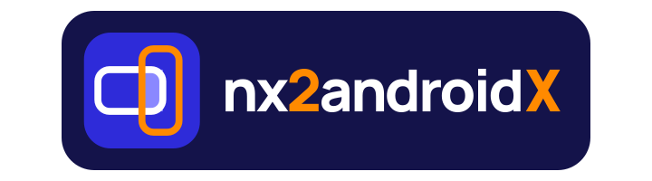
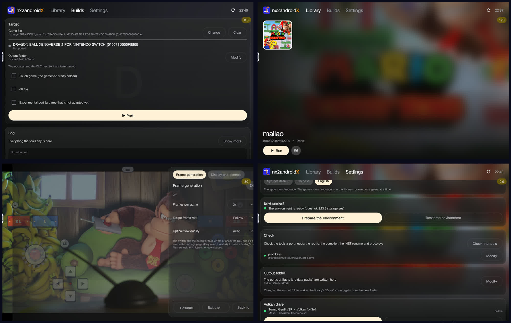

<h1 align="center">
  
</h1>

> **中文文档**。English: [README.md](README.md)

把你的任天堂 Switch 游戏原生移植到安卓手机上：游戏自己的 arm64 代码在设备上直接跑，Switch 的系统服务由一个宿主程序顶替，NVN 图形调用重放到 Vulkan 上。选好游戏文件，点 **移植**，得到游戏的数据包，手机上的 nx2androidX App 负责运行它。

**自带游戏文件和密钥；本仓库不含任何游戏内容。**

本仓库是 nx2androidX，基于 nx2android——PC 端把 Switch 游戏移植打包成 APK 的工具。nx2androidX 把这件事搬到了手机上：游戏文件给它，它在手机上自己编译、自己运行，全程不开电脑。能在安卓上跑的游戏清单在上游：[游戏列表](#游戏列表)。

手机上的 App 就是完整的工具：它在设备上完成移植，也运行自己产出的数据包。你在库里看到的游戏文件，都是你自己的。

---

## 这个安卓分支最近改了什么

这条分支把「手机上直接玩」这件事做成了闭环，App 从一个播放器变成了完整的移植工具。

### 手机 App 现在是完整工具

以前移植要在电脑上做：装工具、选文件、点移植、把数据包传回手机。现在手机上就能发起移植 —— 构建页选一个游戏文件，点 **Port**，移植在后台跑（系统通知栏有「移植进度」），跑完数据包落到输出目录，游戏库里直接就能运行。

游戏库也简化了：以前要挑一个文件夹当库，背后的扫描是递归的，点错一个根目录就是一次长时间卡死。现在**游戏库只收构建页登记过的游戏**，整段扫盘逻辑删掉了；库空的时候只给一句指路提示，不再有按钮。

*左上：构建页选文件发起移植；右上：游戏库里的一个条目；左下：游戏内抽屉的帧生成；右下：设置页（语言、环境、密钥、输出目录、Vulkan 驱动）。*

### 这一版新加的东西

| 功能 | 说明 |
|---|---|
| **手机自编译** | 构建页选文件即发起移植，后台跑完进库即玩，全程不开电脑 |
| **glibc rootfs 环境** | App 自带一套 glibc rootfs，移植工具是 Linux 二进制，直接在设备上原生执行：不用 proot，不需要 root，中间没有兼容层 |
|
| **引导流程修好** | 能走完了、进度不丢；第三步选的 keys 就是移植用的那一份 |
| **游戏是 App 里的一个页面** | 退出游戏回到游戏库，不再跳桌面、最近任务里只有一条 |
| **App 自己的语言** | 中英随时切换（游戏自己的语言仍在库页抽屉里，一个游戏一个） |
| **存档打包分享** | 导出成一个包，走系统分享面板；导入从任意来源收；导入前自动备份 |
| **游戏内抽屉** | ☰ 菜单按钮直接点开，暂停菜单里能调帧生成和画面与操作 |
| **帧生成** | 游戏运行中开抽屉即可用，倍率和目标帧率即时生效 |
| **Vulkan 驱动管理** | 设置页下载（Turnip 构建）/ 从文件导入 / 删除；内置 Adreno 8xx 的 Turnip |
| **启动即查更新** | 静默检查发布页，有新版就在首页提示；设置页也能手动查 |
| **日志可分享** | 游戏库的抽屉里直接分享运行日志，设置页可以清空 |
| **APK 460MB → 272MB** | 手机上的 .NET 从 SDK 换成 runtime：那两个 C# 工具是预编译的，手机只运行不构建 |

### 引导流程

首次启动走四步：存储访问 → 环境 → 密钥 → 完成。环境（rootfs、编译工具和 .NET runtime，约 700 MB）只解压一次，之后更新 App 只带新的小工具，不再重复这一步。跳过的步骤也不要紧，随时能在设置里补，库里的入口会提醒缺什么。

### 存档能打包分享

库页面板里的存档操作变成了「备份 + 分享」：导出把存档打包写进下载目录，面板把它交给系统分享面板；导入从任意来源收包 —— 另一台手机、云盘、控制台存档工具都行。导入会覆盖游戏当前的存档，App 会先自动导出一份备份（目录名以 `-before-import` 结尾），面板里列着所有包和备份，可以恢复、分享或删除。

导入不是来者不拒：包名里带着别的游戏 ID 的包会被拒绝，包里路径越界也会被拒绝，解开后的大小有上限。

### 游戏内抽屉与帧生成

☰ 菜单按钮点开就是游戏内抽屉，两个页签：**帧生成**和**画面与操作**。

帧生成用 Lossless.dll：每游戏帧倍率、目标帧率、光流质量都能调，开关与倍率即时生效，DLL 的更新会自动拷到私有目录。Lossless Scaling 的资源不会被内置，也不会被下载。

画面与操作页签里有虚拟手柄：布局编辑器（拖动按键位置、双指缩放、网格吸附）、手柄不透明度、震动、帧率计数、底座模式。

### 手机上的 Vulkan 驱动

驱动是玩家的，不是数据包的：设置页的 **Vulkan 驱动** 分区里可以下载（Mesa 的 Turnip 构建，从它们自己的地址）、从文件导入、删除。其中一个 Turnip 构建 —— Adreno 8xx 那个 —— 是内置在 App 里的，App 启动时自己展开到私有目录（不联网、不点击），并标记为内置，不归玩家删。

游戏运行时用哪个驱动，在游戏库页的抽屉里选（**Vulkan 驱动**），设备自带驱动排在第一个。选中的驱动写进数据包的 `env.txt`，所以会一直有效，下次启动游戏时生效。

---

## 游戏列表

能在安卓上跑的游戏列在上游仓库，附每个游戏测试时用的 nx2android 版本和跑到的帧率：[Games](https://github.com/shirai91/nx2android#games)。目前已经移植好的、以及接下来要移植的，在 [docs/PORT_CHECKLIST.md](docs/PORT_CHECKLIST.md)。

游戏要求设备的 GPU 能读 BC 压缩纹理（Adreno、Xclipse 可以；Mali、PowerVR 不行）。实测设备是联想拯救者 Y700（骁龙 8 Elite，Adreno 830）。

## 玩家指南：不用写代码也能移植

1. 从 [Releases](https://github.com/zFitness/nx2androidX/releases/latest) 下载 `nx2android-<版本>-windows-x64.zip`（Windows）或 `nx2android-<版本>-macos-arm64.zip`（Apple 芯片的 Mac），解压后启动 **nx2android**（Mac 上先看 [packaging/INSTALL.md](packaging/INSTALL.md#1-start-the-app)）。
2. **Setup** 页：点 **Download missing tools**（Android NDK、.NET SDK 和 platform-tools，约 1 GB，来自 Google 和微软），然后设置你的 **prod.keys**。每一行都会变绿。
3. **Port** 页：选择放着游戏 NSP、XCI、NSZ 或 XCZ 文件的文件夹（本体、更新、DLC），点 **Port**。
4. 移植会把游戏数据包（`<游戏名>-data/`）留在游戏文件夹里。真正玩游戏的是手机上的 nx2androidX App：它在手机自己身上完成移植，然后运行它在自己输出目录里找到的数据包。

手机上的 App 也会顺带看一眼有没有新版本：启动时它安静地检查一次发布页，有新版就在首页告诉你。**设置** 页里有个 **Check for updates**，可以随时手动再查一次。App 自己不下载任何东西 —— 提示只是把你带到发布页，APK 在那儿。

《宝可梦传说 阿尔宙斯》和《宝可梦传说 Z-A》的着色器在 Oodle 压缩包里，只有游戏自己的解码器能打开。在手机上移植时，移植就在手机本机解 —— 手机就是那台跑得动游戏自己代码的机器 —— 不用再准备什么。用桌面工具移植同一款游戏时，这一步跑在你连着的设备上：请备好第 2 步里的 platform-tools（adb），点 **Port** 之前先用 USB 调试连上设备。

用触屏玩的游戏：在 Port 页勾上 **Touch game**（`--touch`）。屏幕手柄一开始是隐藏的，除了菜单按钮以外的触摸都交给游戏；暂停菜单里可以再把手柄叫出来。

在热闹场景里被绘制调用拖慢的游戏：在 Port 页勾上 **Multithread replay**（`--mt-replay`），游戏的 Vulkan 命令会改到单独的线程上记录。下次不带这个选项重新移植之前，它会一直生效。

想摆弄屏幕按键：暂停菜单的 **Gamepad** 页签 → **Edit layout**，拖动可以移动，双指或 **− / +** 可以缩放。**Save** 存下布局下次启动继续用，**Cancel** 丢掉这次改动。**Snap to grid**（默认关，会记住）会显示方格网格，拖动时把控件中心吸附上去。

游戏从 App 的游戏库页打开：那里写着这是哪个游戏、文件在哪、用哪种语言和哪个 Vulkan 驱动来跑。主按钮就是开始游戏，这些选择会写进数据包的 `env.txt`，所以会一直有效。

想在设备自带驱动之外用别的 Vulkan 驱动（比如 Adreno 上的 Mesa Turnip）：把驱动库（.so）放进一个文件夹，在 Port 页设置 **Vulkan driver folder**（`--vulkan-driver-dir`），数据包会把它们都带上，App 里让玩家自己选，设备自带的排第一个。

## 存档

游戏的暂停菜单（Game 页签）里有 **Export save** 和 **Import save**：导出得到的是设备上 `Android/data/<包名>/files/saves/` 里的一个文件夹，存档文件与控制台存档工具导出的格式一致，所以控制台的存档也能同样导入。App 的 **Saves** 页签负责在设备和 PC 之间搬运。

导入会替换游戏当前的存档；App 会先把原来那份导出到设备上（目录名以 `-before-import` 结尾）。卸载 App 会连存档和导出一起删掉，先拷到 PC 上。

## 开发者

从仓库跑起来、命令行、仓库结构、打包、测试和提交信息规范：[docs/DEVELOPMENT_GUIDE.md](docs/DEVELOPMENT_GUIDE.md)。它是怎么搭起来的：[docs/ARCHITECTURE.md](docs/ARCHITECTURE.md)。

## 密钥与游戏文件

nx2android 在移植时用你的 `prod.keys` 解密你的游戏文件，和 Switch 模拟器的做法一样。本仓库和它的发布包里没有密钥、没有游戏文件、没有固件、没有任何从游戏里提取出来的东西，工具也从不下载这些。两者都从你自己的 Switch 导出，不要把它们或者用它们做出来的数据包分享出去。

`nxnative/dm/games/` 下的游戏 profile 只存互通用的元数据：用来识别游戏着色器的哈希、模块内部的偏移、还有几个字节的机器码补丁桩（让某个游戏版本能跑起来）。这些是宿主程序跟游戏打交道需要的信息，不是游戏本身。

到目前为止任天堂的侵权通知发给了项目的托管方（2026 年 2 月有十三个 Switch 模拟器仓库收到），而不是发给玩家。为自己使用而解密自己的游戏是否被允许，取决于你所在的地方。

## 许可

本仓库自己拥有的代码 —— 移植器、桌面工具、手机 App 和打包部分 —— 是 MIT：[LICENSE](LICENSE)。它所基于的引擎 nxnative 也是 MIT（[nxnative/LICENSE](nxnative/LICENSE)），树里的第三方代码保留各自的许可，每个组件都列在 [THIRD_PARTY_NOTICES.md](THIRD_PARTY_NOTICES.md)。

有一个例外：手机 App 的帧生成（[nxnative/dm/android/lsfg/](nxnative/dm/android/lsfg/)）是 GPL-3.0-or-later，所以 App 构建出来的宿主程序在这个许可下属于衍生作品，除非构建时不带它。这对 App 意味着什么、以及怎么拿到一个 MIT 的构建，见 [android/NOTICE.md](android/NOTICE.md)。

## 致谢

这条分支是一个家族里的一支，它脚下是别人的地基：

- **[nx2android](https://github.com/shirai91/nx2android)** —— 本仓库基于的项目：PC 端把游戏移植打包成 APK；本仓库是它的手机端。
- **[seedds/nxnative](https://github.com/seedds/nxnative)** —— 它底下的引擎：顶替主机系统服务的宿主程序、NVN 到 Vulkan 的图形重放、着色器翻译器，以及这些移植大多参照过的游戏 profile。MIT 许可，我们的 fork 在 `nxnative/` 里。
- **nxnative 的各位贡献者** —— 引擎、工具链和 profile 都是他们写的。
- **[NX2Apple](https://github.com/LNPANDY/NX2Apple)** —— 同一条引擎的苹果路线：macOS 构建器和 iPhone/iPad 共享的游戏库。谢谢他们让这条路在苹果设备上一直活着。
- **[BananaNative](https://github.com/Raphix91/BananaNative)** —— 把引擎带到安卓、让几款 Switch 2 游戏在手机上原生跑起来的分支。谢谢他们走到比我们更远的地方。
- **[Mesa](https://www.mesa3d.org/)** —— Turnip，安卓 App 可下载的 Adreno Vulkan 驱动。
- **Lossless Scaling** —— Lossless.dll，App 可选的帧生成器；它的资源这里既不内置也不代下载。
- **[Ryujinx](https://github.com/Ryujinx/Ryujinx)** —— 着色器翻译器，以及图形路径依赖的 NVN 声明。
- **所有提 issue、投补丁、写游戏 profile、翻译文档的人** —— 这条分支也站在他们的工作上。

树里每个组件保留自己的许可，清单见 [THIRD_PARTY_NOTICES.md](THIRD_PARTY_NOTICES.md)。

## 商标

这份 README 里出现的游戏名和商标，用来标明本工具兼容哪些游戏。它们属于任天堂以及各自的发行商与开发者。截图是 App 本身，跑的是玩家自己的游戏文件。本项目与它们没有任何关联，也未得到它们的认可。
